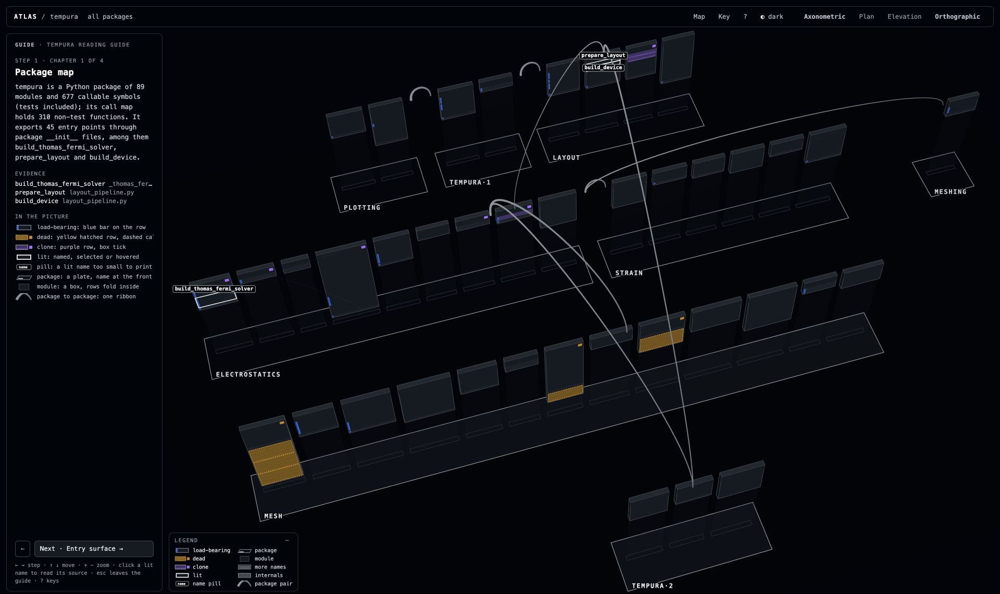
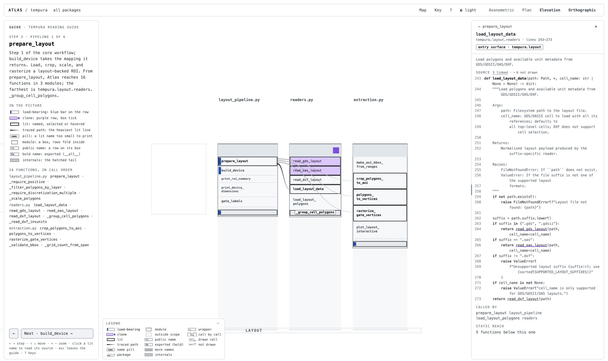

# Atlas

Atlas turns a Python project into an interactive map you can explore locally.
Start with a guided tour, follow calls between modules, and open the source
without losing your place.



## Try it

From this repository, install the environment and analyze a project:

```sh
pixi install
pixi run atlas explore --where /path/to/project
```

Open `/path/to/project/.atlas/explorer/index.html` in a desktop browser with
WebGL 2 support. The export includes its data and JavaScript: no server,
account, or internet connection is needed. Share the whole `explorer` folder.

For several projects, run `pixi run atlas dashboard`. Its local dashboard lets
you register folders, refresh their analysis, and switch between them.

## How it works

Atlas reads Python syntax without importing or running your project. It finds
functions, classes, imports, and calls it can resolve statically. Python then
builds a deterministic layout and a reading guide; the browser draws the map.
Dynamic calls can remain unresolved. The guide uses analysis rules, not AI.

Packages sit on plates, modules appear as boxes, and their public names form
rows. Unfold a module to see its functions and classes. Connections show calls;
Plan view shows imports. The legend explains signals such as duplicate code,
unused private functions, and import cycles.

- Follow **Next** through the guide, or choose **Map** to explore freely.
- Select a package or module in the scope tree; click a name to read its source.
- Click an underlined call to inspect its target. **Backspace** returns.
- Use **1 / 2 / 3** for camera views, **Home** to fit, and **Esc** to step back.
- Press **?** for all controls and **T** to change the theme.



Analysis lives in `.atlas/atlas.json`; the reading path lives in
`.atlas/atlas-story.json`. [Customize the guide](docs/guide.md) to choose your
own entry points. Atlas also writes an Obsidian-compatible architecture vault.

## Development

```sh
pixi run test
npm ci
npm run lint
npm test
npm run build
```

Node is needed only to change the browser code. Commit the rebuilt bundle with
its source so Python installations can generate exports immediately.

Licensed under [GPL-3.0](LICENSE). Bundled Three.js uses the
[MIT license](src/atlas/explorer/static/THREE-LICENSE.txt).
