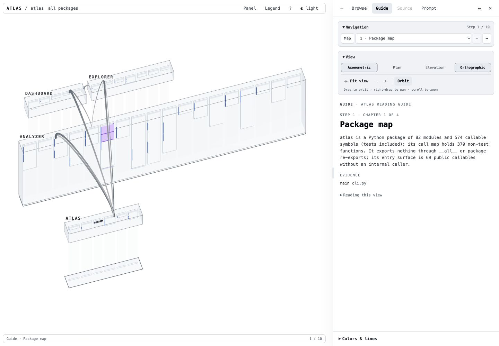
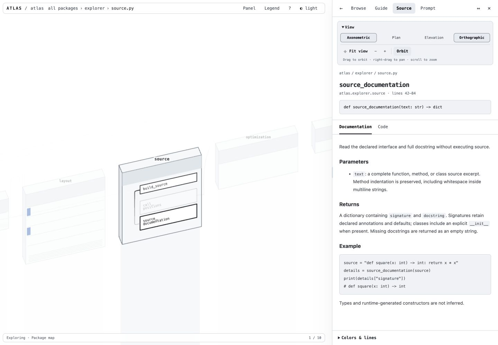

# Atlas

Atlas turns a Python project into an interactive map you can explore locally.
Start with a guided tour, follow calls between modules, and open the source
without losing your place.



## Try it

Atlas requires Python 3.11 or newer. From this repository, install the environment
and analyze a project:

```sh
pixi install
pixi run atlas explore --where /path/to/project
```

Open `/path/to/project/.atlas/explorer/index.html` in a desktop browser with
WebGL 2 support. The export includes its data and JavaScript: no server,
account, or internet connection is needed. Share the whole `explorer` folder.

For several projects, run `pixi run atlas dashboard`. Its local dashboard lets
you register folders, refresh their analysis, and switch between them.

## How it works

Atlas reads Python syntax without importing or running your project. It finds
functions, classes, imports, and calls it can resolve statically. Python then
builds a deterministic layout and a reading guide; the browser draws the map.
Dynamic calls can remain unresolved. The guide uses analysis rules, not AI.
Callable references in callbacks, closures, and local object uses also count
toward reachability. They are saved as evidence separately from direct calls,
so they do not inflate call counts or draw misleading connections.

Each package has one open-front enclosure and labeled base, with its source files
inside. Solid back and side walls hide packages behind it. Packages stay together even when their dependencies form a cycle.
Rows leave room for tall boxes, and labels behind solid faces stay hidden.
Modules appear as boxes, and their public names form rows. Unfold a module to
see its functions and classes. Connections show calls; Plan view shows imports. **Colors & lines** stays available in the shared panel;
**Legend** (or **K**) explains every color and line style, including structural
clones, possibly unused functions, and import cycles.

- **Navigation** appears only in the Guide tab, with tutorial arrows and a step selector.
  Choose **Map** to explore freely. The separate **View** box keeps camera views, zoom,
  Orbit, and Fit view available in every tab.
  Expand a module in the guide to see its functions. **Orbit** keeps your guide step.
- The **Prompt** tab offers a copyable handoff for your coding agent at any step,
  with finding counts, selected source evidence, and a cleanup proposal. Full
  details stay in `.atlas/atlas.json`. The prompt is generated
  locally; possible dead code and clones still need verification before changes.
- **Browse**, **Guide**, **Source**, and **Prompt** share one full-height, resizable panel. Search with **B**,
  select a symbol, or use the source breadcrumbs to return to its module.
- **Source** has **Documentation** and **Code** tabs beneath the declared signature,
  including parameter types, defaults, and return annotations. Documentation renders the
  full docstring and Markdown examples; missing docstrings are marked explicitly.
  Source syntax uses GitHub high-contrast colors matched to the light or dark theme.
  Click an underlined call to inspect its target. **Backspace** returns;
  expandable **Callers**, **Calls**, and **Reaches** lists show its relationships.
- **Orbit** starts enabled: drag to rotate, right-drag to pan, and scroll to zoom.
  Turn Orbit off to pan with a normal drag.
- Use **1 / 2 / 3** for camera views and **Fit view** or **Home** to recover a clear view.
  Opening, closing, or resizing the panel fits the map to the remaining space.
- Press **?** for all controls and **T** to change the theme.



Analysis lives in `.atlas/atlas.json`; the reading path lives in
`.atlas/atlas-story.json`. [Customize the guide](docs/guide.md) to choose your
own entry points. Atlas also writes an Obsidian-compatible architecture vault.

## Documentation deployment

GitLab CI builds Atlas’s own interactive documentation after the checks pass on
`main`. The Pages homepage includes the guide, source reference, and cleanup prompt.
The pipeline’s **documentation** environment links to the published site. Generated
exports stay in CI artifacts; they are not committed to the repository.

## Development

```sh
pixi run test
npm ci
npm run lint
npm test
npm run build
```

Node is needed only to change the browser code. Commit the rebuilt bundle with
its source so Python installations can generate exports immediately.

Licensed under [BSD-3-Clause](LICENSE). Bundled Three.js uses the
[MIT license](src/atlas/explorer/static/THREE-LICENSE.txt). Markdown rendering
[licenses](src/atlas/explorer/static/MARKDOWN-LICENSES.txt) are included in every export.
